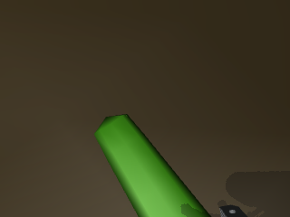
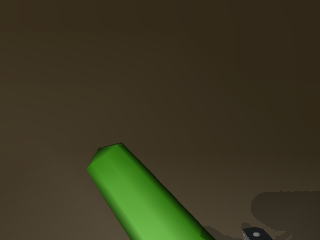
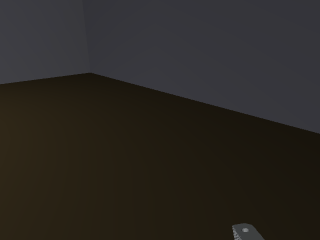

# 05. ACT: контракт, восстановление отказа и пределы причинного вывода

## Источники

Код: `simulator/learning.py::LoadedPolicy`, `simulator/room_policy.py::RoomActor.command/issued_command`, `src/mobile_policy_contract.py::clock_features/decode_policy_action/bound_action`; точные строки и SHA — [SOURCE_FUNCTION_INDEX.md](evidence/SOURCE_FUNCTION_INDEX.md). Поведение библиотечной очереди — сохранённый `source_external/lerobot_act_policy_methods.py`. Срез функционального кода: `1da8ecb26efaa798d4293f126d7d123aff7985e5`; документация `bded49e` не меняла этот runtime.

## Текущий learner

VERIFIED: LeRobot 0.6.1, ACT, 11 905 481 параметр; ResNet18/ImageNet initialization, dim128, heads4, FF512, encoder2/decoder1, VAE off, dropout0, temporal ensemble off. Chunk20, n_action_steps20; queued действия не пересчитывают сеть по новому изображению. Номинальный период действия .05 с, fresh forward обычно раз в 20 решений, а не 20 новых forward/с.

Вход: wrist RGB320×240, 9D command estimate, 14D Fourier clock. Выход: абсолютные 6 servo endpoints в градусах и 3 body velocities; action_transform=None у исследуемого bundle. State/ACTION нормализуются сохранёнными MEAN_STD, RGB — сохранённым processor, clock — identity. L1 imitation loss; AdamW lr5e-5/backbone1e-5, weight_decay1e-4, betas .9/.999, eps1e-8, clipping10; scheduler=None. Batch32, loader2, save1000. Число планируемых обновлений 145799, а не число физических попыток.

## Конкретный отказ

VERIFIED: diagnostic `live-room-395c6a0365d9`, scene1703000014, checkpoint9000, model SHA `eacea46e67a89b9e79dc35de5ef2dc958b03569b2ae727e54975b3df9e8e5c61`. Полный trace в [actions.jsonl](examples/refusal-695/actions.jsonl), восстановленные тензоры/выводы — [refusal_forensics.json](examples/refusal-695/refusal_forensics.json), обработанные входы — [normalized_inputs.npz](examples/refusal-695/normalized_inputs.npz).

На step695:

```text
phase=pick; execution_step=695; queued=false; elapsed_s=40.74999999999984
reference=[90,123,37,0,80,48,0,0,0]
prediction≈[89.5934,115.1323,45.1423,0.7460,80.5262,75.8205,
            0.00008273,-0.00011402,-0.00000399]
gripper_delta=+27.8205° → raw 20° guard → refusal joint6
```

Не было clipping до «разрешённых +2°» после принятия заведомо недопустимого raw действия. Сначала `bound_action` отклоняет raw скачок >20°, затем только для принятого действия ограничивает исполнение 2°. Для свежего прогноза cached-only replan не применяется. Это объясняет механизм отказа, но не причину, по которой сеть дала такой target.

## Изображения







Качественное ручное наблюдение: в начале носок виден крупно, в кадре 695 преобладают пол/стена, снизу видна небольшая часть механизма; носок визуально не подтверждается. Это не сохранённый семантический detector verdict и не доказательство истинного положения ткани. Но такое изменение наблюдаемости существенно для анализа политики. Не следует предполагать, что на всех 695 решениях сеть видела предмет одинаково хорошо.

## Какие значения восстановлены и какие отсутствуют

| Величина | Источник / статус |
| --- | --- |
| RGB и прежние кадры | VERIFIED, оригинальные PNG, hash raw RGB проверяется |
| Command state, phase, clock | VERIFIED, observation/result trace |
| Нормализованный state/RGB/clock | Воспроизводится read-only скриптом из сохранённых processors; массивы включены |
| Полный normalized chunk20×9 | Воспроизводится тем же checkpoint в eval/no_grad; JSON включён |
| Денормализованный chunk | Восстановлен сохранённым postprocessor; проверяется совпадение первой команды |
| Применённые команды | VERIFIED, события `applied`; proposed/refused отдельно |
| Истинные qpos/qvel/contact/cloth всех шагов | UNKNOWN: полного покадрового сохранения исходного физического состояния нет |
| Правильное действие teacher в точно этом состоянии | UNKNOWN: такого counterfactual в старом эпизоде не записано |
| Успех физического воспроизведения | Не заявляется: скрипт вообще не шагает симуляцию |

Результат точного numerical replay и clock/RGB-counterfactuals дописан ниже автоматически. Пересчёт на CPU может иметь небольшие численные отличия; обязательна указанная tolerance, а не ожидание одинаковых байтов разных backend.

## Проверка конкурирующих объяснений

| Гипотеза | Подтверждающие факты | Что ей противоречит / чего не хватает | Минимальная развилка |
| --- | --- | --- | --- |
| Неверная нормализация | Большое расхождение gripper | Processors закреплены; предыдущее сравнение normalizer SHA совпало; numerical replay проверяет путь | Roundtrip нормализации реальных targets, сравнение тренировочного и runtime batch |
| Absolute/delta confusion | Выход может выглядеть как большой скачок | Bundle action_transform=None, decode не прибавляет reference | Проверить export target against raw row на 32 примерах; одинаковые processors |
| Clock/phase conflict | Explicit Fourier clock, experimental handoff, изменённая длительность | Наличие clock не доказывает, что RGB игнорируется | Один RGB/state при нескольких clock; затем физические clock-ablation на новом эксперименте |
| Action chunk stale | Хвост очереди может отставать от ограниченного исполнения | Именно этот отказ `queued=false`, поэтому старый хвост не единственное объяснение | Анализ trace fresh/cached и фактического периода; не разрешать бесконечный resample |
| Target выше runtime actuator limit | Teacher changes до 3.6°/кадр, runtime2° | +27.82° намного больше разницы одного лимита | Сравнить командную ошибку накопленно на одном и том же teacher rollout |
| Потеря визуальной наблюдаемости / OOD | Кадр 695 отличается от начала, полного sock подтверждения нет | Нет экспертной target-метки в этом student состоянии | Соседи в RGB+state+clock и новые наблюдаемые экспертные коррекции |
| Противоречивые показы | Несколько teacher families и близкие команды, incomplete profile provenance | Near-duplicate commands не доказывают конфликт одинаковых входов | Кластеризовать одинаковую фазу/state/RGB/clock и измерить variance expert targets |
| Command estimate ≠ physically executed | Ограничение скорости, динамика, нет encoder state на factory runtime | Исходные qpos/qvel не сохранены для точного восстановления | Новая конечная симуляционная проверка с полным state logging, без изменения guard |
| Недообучение | Snapshot9000 промежуточный, текущий budget145799 | И предыдущие долгие обучения не гарантировали успех | Малый overfit + recovery test до большого train; сравнить одинаковый runtime |

## Ответы на 20 вопросов задания

1. ACT выбрана как уже интегрированная компактная imitation policy, с действующим LeRobot/MPS путём. Это прагматическое обоснование, не доказанное превосходство над альтернативами.
2. Для локальной моторики применимость STRONGLY_SUPPORTED литературой, для данного ROSMASTER надёжность UNKNOWN. Для полного поиска текущая сеть не обучена: навигация внешняя.
3. При разных допустимых expert modes детерминированная L1-политика без latent/ensemble может давать компромисс; наличие такого конфликта в конкретных inputs требует измерения.
4. Командный аудит 739 записей нашёл 1595 близких пар/524 cross-split. Визуальная и state-aware проверка — в 06, ограничения выборки указаны.
5–6. Timing shortcut — HYPOTHESIS. Проверяется clock/RGB counterfactual, а не названием Fourier.
7. Distribution shift подтверждён в структуре: local teacher против full-room handoff и student states. Его количественная причинная доля UNKNOWN.
8–9. Единицы восстанавливает сохранённый unnormalizer; raw и denormalized chunk включены. Повторная незаметная нормализация при resume запрещена.
10. Фазы переключает координатор; часы pick/place предлагаются из учебных записей, затем очередь сбрасывается.
11–12. Chunk20 хранится очередью; cached refusal может вызвать максимум ограниченные replan. Fresh unsafe отказ прекращает этап.
13. Известный лишний физический stop-tick исправлен cfe4aa7; regression10/10 секунд не доказывает grasp.
14. Механизм скачка воспроизводим; единственная первопричина UNKNOWN до различающих экспериментов.
15. Да, контрактное расхождение возможно; numerical/target roundtrip и aligned teacher replay — необходимая проверка.
16. Да, такая неоднозначность возможна; текущая ограниченная выборка не доказывает и не исключает её для всех кадров.
17. Начальная поза унифицируется median handoff; чувствительность к иным позам ещё не принята.
18. Размеры/скейлы input согласованы в коде; распределения наблюдений не обязаны совпадать. «Одинаковая shape» недостаточно.
19. Скрытая истина записана в diagnostics, но whitelist экспортирует actor inputs отдельно. Точные train/val SHA/seed не пересекаются; semantic scene leakage не исключается.
20. Одна wrist RGB без видимого объекта и measured joints может быть частично наблюдаемой; достаточность input для всех фаз UNKNOWN. Добавление глубины/памяти/геометрии требует controlled ablation, а не обещания.

## Численный результат read-only replay

VERIFIED: CPU replay первой команды совпал с исторической **точно**: max absolute error `0.0`. Guard снова отказал: `{'accepted': False, 'reason': 'Недопустимый шаг сустава 6'}`.

Нормализованный state: `[0.5570611953735352, 2.0268800258636475, -1.6272655725479126, -0.6606210470199585, -1.1539440155029297, -0.4596783220767975, -0.2421119213104248, -0.31709590554237366, -0.13901345431804657]`.

Полный денормализованный gripperchunk: `[75.821, 68.492, 57.572, 45.856, 37.854, 36.511, 36.169, 36.255, 36.386, 36.545, 36.581, 36.46, 36.581, 36.617, 36.555, 36.434, 36.377, 36.198, 36.301, 36.357]`.

| Counterfactual | Clock, с | Gripper,° | Shoulder,° | Elbow,° |
| --- | --- | --- | --- | --- |
| clock | 0.00 | 77.1348 | 112.4788 | 47.3082 |
| clock | 6.00 | 91.1880 | 116.1496 | 47.0313 |
| clock | 12.00 | 80.7144 | 112.8216 | 48.6197 |
| clock | 24.00 | 100.0883 | 113.4207 | 46.2944 |
| clock | 35.00 | 74.5079 | 112.7584 | 47.6159 |
| clock | 40.75 | 75.8205 | 115.1323 | 45.1423 |
| clock | 43.55 | 72.5858 | 113.9019 | 47.3432 |
| clock | 50.00 | 74.7436 | 112.9676 | 48.6119 |
| black_rgb | 40.75 | 72.1881 | 126.5828 | 46.6940 |
| gray_rgb | 40.75 | 54.7828 | 126.2247 | 38.8231 |

Часы и RGB влияют на прогноз. Это опровергает слишком сильный вывод«изображение вообще не используется», но не доказываетдостаточную visualreactivity. Gray/black контрфактуалы OOD и не успешные физические эксперименты.

На 694 применён gripper48°, cachedtarget48.1484°. Следующий freshforward695 выдал 75.8205°: меж chunk разрыв≈27.6721°. В trace естьодин cachedreplan;695 не cached. Доказаначисленнаядискретностьнагранице, еёобучающаяпричинанеизолирована.
