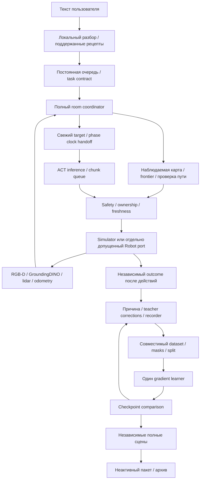

# 09. Архитектура и отсутствующие связи

VERIFIED как структура исходников; статус реального прохождения каждой связи отмечен отдельно. Источник: фиксированный runtime1da8ecb, [индекс функций](evidence/SOURCE_FUNCTION_INDEX.md), [снимок](17_CURRENT_SYSTEM_SNAPSHOT.md).

| Компонент | Файл / функция | Вход → выход / контракт | Частота / зависимости | Реальная зрелость |
| --- | --- | --- | --- | --- |
| Natural-language | language_learning, automatic_learning | текст → поддержанный task/scene recipe | По запросу; локальная LLM или шаблоны | VERIFIED ограниченные семейства; NOT_IMPLEMENTED произвольная новая моторика |
| Queue | automatic_learning, room_control | immutable request → один owner/state | Фоновый polling, explicit operator pause | Работает, были stale PID/UI состояния |
| Task planning | src/skill_planner.py, task_executor.py | predicates/permissions → план доступных навыков | По переходу/сбою | Символьная композиция, не автоматическое изобретение физического навыка |
| Semantics | semantic_vision.py::SemanticDetector | текущий RGB/text → detection hypotheses | По остановленным обзорам, холодный старт может быть долгим | Grounding model pinned; не trained sock-specific detector |
| Metric perception | rgbd_observation, multiview_container | RGB-D+FK → наблюдаемые bounds/uncertainty | При свежем кадре/новой позе | Некоторые обзоры были недостижимы; часть исправлена на одной сцене |
| Navigation | scan_navigation, room_navigation, observed_navigation | наблюдённые scans/pose → checked path | Между наблюдениями; текущая частота зависит от solver/сенсоров, не 20Hz neural | Классический алгоритм; whole-room competence не принята |
| Phase handoff | room_policy.py::build_profile/place_clock/RoomActor.begin | training-derived phase+observed target+command → start clock/state | На фазе pick/place | Экспериментальная композиция; принципиальный distribution shift |
| ACT | learning.py::LoadedPolicy | RGB/state/clock →9D absolute chunk20 | 20 decisions/s; nominal fresh network1/s без дополнительных reset | Реальные веса; последний full diagnostic без grasp |
| Safety | contract::bound_action, inspection_planning | prediction+reference+CAD+fresh target → допустимая команда либо отказ | Каждая команда/проверка пути | Guards действуют; не ослаблять для прохождения теста |
| Simulator | environment.py::ExplorerEnv | issued controls → physics/RGB-D | physics .002s; actor nominal .05s | Оценочная динамика, не принятый цифровой двойник |
| Robot port | observed_robot, room_cleanup_execution/RPC | тот же контракт → штатный host executor | Реальная частота нового пакета UNKNOWN | Нет измеренных joint angles; текущая real qualification отсутствует |
| Outcome | room_validation.py::independent_outcome | финальное физическое состояние →success/diagnostics | Только после действий | Отдельно от actor; актуальное состояние, не ever-success |
| Dataset | learning.py::inspect_episode/export_dataset | verified source+mask →LeRobot/provenance | Отдельная стадия; I/O/cold cache | Старые данные сохранены; semantic leakage не исчерпан |
| Training | train_entry, learning::train_job | frozen dataset/config →weights+optimizer/RNG | Gradient updates; save1000 | MPS измерена; сейчас operator paused |
| Selection | neural_recovery, room_learning | reference+candidates →paired results | Конечные физические тесты | Локально 2→5/10; room-selection ещё не завершена |
| Qualification/transfer | room_transfer, room_archive |100full successes+hashes →inactive Jetson package | Только после gates | Для актуальной полной миссии UNKNOWN: полная квалификация не пройдена |

## Почему room-cycle ждёт локальный

`room_validation.run` проверяет текущего neural recovery owner и ожидание сохраняется, пока он активен. Это предотвращает конкуренцию writer/checkpoint/resource leases. Но локальная recovery-программа может выполнить несколько длинных раундов; поэтому основная полная задача получает обратную связь поздно. Это архитектурный trade-off, а не необходимость самой ACT.

С 19.10 один stable-checkpoint observer позволяет раньше запускать ограниченную CPU диагностику полной миссии, не создавая второй gradient writer. Он не должен ждать «все 145799», но зависит от checkpoint integrity, бюджета памяти и интервала. Повторы одной сцены после изменения runtime не являются independent acceptance.

Следующая архитектура должна разделять: writer lease, read-only snapshot lease, perception/render memory и физический actor. Границы данных/версий остаются неизменяемыми. Предлагать это как будущее улучшение можно; считать уже реализованным весь такой scheduler нельзя.

## Что универсально и что специализировано

Переиспользуемы журнал/manifest/hash, единый action contract, recorder, checkpoint/optimizer resume, ownership, sensor adapters и разделение actor/evaluator. Частично универсальны typed task planner и backend loaders.

Специализированы: sock material patch selection, fixed gripper convention, basket rim/opening geometry, phase clock и диапазон высот, параметры student intervention и критерии sock-inside-basket. Четыре scene templates — не универсальный automatic domain generator. Язык выбирает реализованный recipe; код не создаёт надёжного teacher/reward/control для любого нового глагола.

Отсутствует доказанный автоматический цикл выбора и модификации произвольного алгоритма по новой неизвестной причине. Есть конечные известные recovery operators и инженерное вмешательство после `needs_*_repair`.
